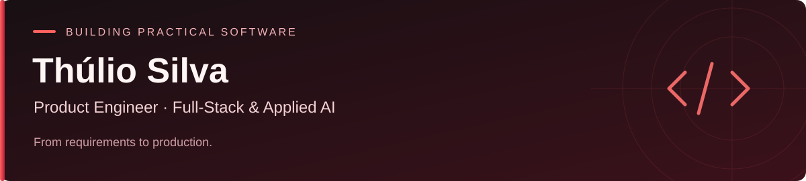

  

  <a href="https://www.linkedin.com/in/thuliovs/">LinkedIn</a> ·
  <a href="mailto:contact@thulio.tech">Get in touch</a>

I’m Thúlio, a Product Engineer based in Portugal. I turn business requirements into working software, with hands-on responsibility across frontend, backend, data modelling and integrations.

My professional work includes **M3 Nexus**, an industrial ERP for 3D manufacturing built with Next.js, React, Node.js and PostgreSQL. I work across the product lifecycle, from understanding operational needs and designing the system to shipping features and supporting production.

### What I work with

**Core stack** · TypeScript, JavaScript, React, Next.js, Node.js, PostgreSQL  
**Engineering interests** · System design, relational data, enterprise integrations, automation and applied AI  
**Beyond the web** · Rust, Python, Kotlin, Android and Linux through personal projects

### Selected projects

| Project | What I’m building or exploring | Technologies |
| :--- | :--- | :--- |
| [justwork](https://github.com/thuliovs/justwork) | A local-first job radar for software engineering roles, with ATS collection, explainable eligibility rules and conservative deduplication. | TypeScript · PostgreSQL |
| [anchor](https://github.com/thuliovs/anchor) | An experimental motion pipeline connecting Android sensors to real-time desktop processing, calibration and visual cues. | Kotlin · Rust · Tauri · UDP |
| [thecontrarian](https://github.com/thuliovs/thecontrarian) | A web platform for client–writer contracts and PayPal subscription workflows. | Python · Django · PayPal |
| [missed](https://github.com/thuliovs/missed) | An early-stage Android prototype for location-based reminders. | Kotlin · Jetpack Compose · Google Maps · Firebase |
| [thinkpadlike_grubtheme](https://github.com/thuliovs/thinkpadlike_grubtheme) | A minimal black, white and red GRUB theme inspired by classic ThinkPad design. | GRUB · Linux |

Each repository documents its current scope, setup and limitations.

### How I approach engineering

- Start with the workflow and the people who use it.
- Connect product decisions to architecture, data and implementation.
- Use automation and AI-assisted development where they help, with human review and validation.
- Keep systems understandable through clear documentation and practical trade-offs.

Outside work, I enjoy electronics, Linux and experimenting with the boundary between hardware and software.

  

